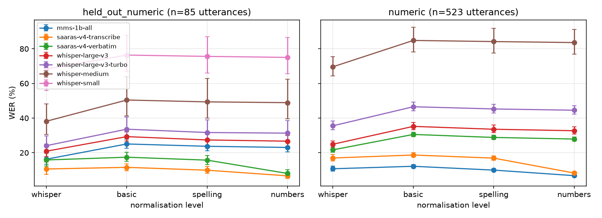

# indic-asr-eval-audit

[](https://github.com/berserkersap/indic-asr-eval-audit/actions/workflows/ci.yml)

Auditing how Indic ASR is evaluated: number-aware metrics and synthetic-vs-real test sets.

Hindi ASR is usually compared by word error rate (WER) after some text
normalisation. This repo asks two questions about that practice, on real
Hindi speech, with confidence intervals:

- **RQ1.** How much of a reported WER comes from the scoring convention rather
  than from recognition, and does WER rank systems the same way as the error
  that matters for voice payments and forms: getting the numbers right?
- **RQ2.** Does a TTS-generated test set of the same sentences rank systems the
  way real speech does?

Results so far cover RQ1 for five open models and Sarvam's Saaras v4 in two
output modes, and RQ2 for the five open models with two TTS engines
(MMS-TTS and Sarvam's Bulbul); see the [research log](#research-log).

Two terms used throughout: the **numeric value error** is the share of numbers
written as digits in the reference whose value is missing from the
hypothesis, after spoken numbers on both sides are parsed ("तिरेपन" and "53"
are the same value). **Held-out** utterances are FLEURS test and dev, which
MMS was not fine-tuned on (Whisper's training data is not public, so overlap
cannot be ruled out).

## Key takeaway

On FLEURS Hindi, with five open ASR systems, Sarvam's Saaras v4, two TTS
engines for synthetic copies of the test set, and 95% cluster-bootstrap
intervals:

- **WER and the numeric value error disagree about MMS-1B.** On held-out
  utterances with numbers (85 utterances, 135 numbers), MMS-1B has the lowest
  WER of the five open systems (23.1%) but misses 67 of the 135 numbers (49.6%),
  2.7 times as many as Whisper large-v3 (25, 18.5%). Against both Whisper large
  models the two metrics rank MMS in opposite order, and both differences are
  significant. Forgiving close misspellings of number words (within 0.25
  normalised edit distance) changes this very little, so it is not an
  artefact of strict spelling. Among the four Whisper models the two metrics
  agree. The sample is small and the intervals are wide, but where numbers
  matter, WER alone would pick the wrong one of these two systems.
- **WER can barely see numbers.** Numbers are 6% of the reference words, so
  word errors on numbers (any error that involves a word with a digit)
  account for only 4.0 of MMS's WER points, although it misses 67 numbers.
  For the open systems, normalising spelling and numbers changes WER by only
  1 to 3 points.
- **At least three quarters of the gap between Saaras v4's two output modes
  is how numbers are written.** One model id (`saaras:v4`) on the same audio,
  with only its `mode` setting changed, scores 5.9 WER points worse in
  `verbatim` mode (numbers as spoken words) than in `transcribe` mode
  (numbers as digits) after basic normalisation, but only 1.4 [0.4, 2.4]
  points worse once numbers are normalised (1.5 on all utterances with
  numbers). Without numbers the two modes differ by at most
  0.3 points, with intervals that include zero. The remaining 1.4 points are
  partly a parser gap (see the note under the convention table), so three
  quarters is a lower bound. Whether the two modes share weights is not
  public; training on FLEURS would affect this comparison less than one
  across models, though it could favour `transcribe`, whose digits match the
  references.
- **Saaras v4 has the lowest WER at every normalisation level** (held-out with
  numbers: 6.7% in `transcribe` mode at the `numbers` level, 11.6% at `basic`;
  6 of 135 numbers missed). Whether FLEURS was in its training data is not
  known, so this is not a like-for-like comparison with the open systems and
  does not show that Saaras is better in general.
- **The stock Whisper normaliser makes Hindi WER look 8 to 12 points lower**
  for each open system on the held-out set (8 to 19 points across all
  subsets), because it deletes vowel signs and so splits words. It does not
  change the ranking. For Saaras it is smaller: on the held-out set +0.9
  [-2.4, +3.5] and +1.6 [-2.0, +4.5] points from `whisper` to `basic` (not
  significant), and 1 to 3 points across all subsets (significant on the
  controls and, for `verbatim`, on all utterances with numbers).
- **The TTS engine sets whether a synthetic test set looks harder or easier
  than real speech, and it can blur a real difference between systems.** On
  the 49 held-out sentences with numbers, MMS-TTS audio raises WER by 7 to 12
  points for the three strongest systems (MMS-1B, Whisper large-v3 and
  large-v3-turbo), clean or telephony, while Sarvam's Bulbul lowers it by 7 to
  9 points for the two Whisper large models and by only about 3.5 for MMS-1B
  (not significant). On real speech MMS-1B leads Whisper large-v3 by 2.9
  points [0.1, 5.6], just clear of zero; on Bulbul audio large-v3 is 1 to 2 points ahead, with
  intervals that include zero. That is a near-tie that changes sign, not an
  established reordering, but it lowers Kendall tau to 0.80, where a second
  real recording gives 1.00; with MMS-TTS no pair swaps order. On numbers,
  MMS-TTS raises the numeric value error by 13 to 24 points for the three
  strongest systems, while Bulbul changes it by -4 to +3 points for the
  Whisper large models but raises it by 10 to 11 for MMS-1B (79 numbers, no
  intervals). Intervals ignore speaker dependence, five systems make a weak
  ranking test, the engines differ in more than one way (one voice against
  eight), and each is one sample of what synthetic speech does.

## Summary of results

### RQ1: scoring conventions (FLEURS Hindi, held-out utterances with numbers)

<!-- rq1-size -->
85 utterances, 56 sentences, 2239 reference words, of which 135 are numbers written as digits.
<!-- /rq1-size -->

WER (%) at four normalisation levels, and the numeric value error (%), strict
and lenient (near-miss spellings of number words are forgiven; wrong digits
and wrong valid numbers never are). 95% cluster-bootstrap intervals; sorted by
WER at the `numbers` level.

<!-- rq1-wer -->
| system | WER whisper | WER basic | WER spelling | WER numbers | numeric value error | lenient numeric error |
|---|---|---|---|---|---|---|
| `saaras-v4-transcribe` | 10.6 [7.5, 14.7] | 11.6 [9.7, 13.6] | 9.9 [8.0, 12.1] | 6.7 [5.2, 8.3] | 4.4 [0.8, 9.1] | 4.4 [0.8, 9.1] |
| `saaras-v4-verbatim` | 15.8 [12.2, 20.3] | 17.4 [14.9, 20.3] | 15.7 [13.2, 18.5] | 8.0 [6.3, 10.1] | 8.9 [3.2, 15.3] | 8.9 [3.2, 15.3] |
| `mms-1b-all` | 16.2 [13.4, 20.1] | 25.1 [22.6, 27.9] | 23.7 [21.1, 26.6] | 23.1 [20.4, 25.9] | 49.6 [39.1, 60.1] | 48.1 [37.9, 58.7] |
| `whisper-large-v3` | 20.9 [17.7, 25.0] | 29.3 [26.8, 32.1] | 27.4 [24.3, 30.6] | 26.7 [23.5, 30.0] | 18.5 [7.8, 29.9] | 17.0 [6.8, 27.8] |
| `whisper-large-v3-turbo` | 24.1 [19.6, 29.7] | 33.6 [29.0, 40.6] | 31.7 [26.6, 39.0] | 31.3 [26.3, 38.6] | 23.7 [13.3, 35.2] | 23.0 [12.9, 33.8] |
| `whisper-medium` | 38.2 [30.7, 48.1] | 50.4 [41.3, 63.9] | 49.4 [39.9, 62.8] | 48.9 [39.5, 62.4] | 35.6 [23.9, 46.8] | 35.6 [23.9, 46.8] |
| `whisper-small` | 68.3 [55.9, 83.4] | 76.4 [66.9, 87.8] | 75.6 [66.0, 87.1] | 75.0 [65.5, 86.5] | 78.5 [69.2, 86.3] | 77.0 [67.5, 84.8] |
<!-- /rq1-wer -->

Pairs of systems that WER (at the `numbers` level) and the numeric value error
put in opposite order. A reversal is significant when the paired bootstrap
intervals of both differences exclude zero; the two significant pairs share
MMS, so they are not independent. No correction is made for testing several
pairs, but the two numeric-error intervals clear zero by about 11 points or
more.

<!-- rq1-disagreement -->
| subset | systems | Kendall tau | reversed, significant | reversed, not significant |
|---|---|---|---|---|
| held-out, with numbers | 7 | 0.71 | `whisper-large-v3-turbo` vs `mms-1b-all`, `whisper-large-v3` vs `mms-1b-all` | `whisper-medium` vs `mms-1b-all` |
| all with numbers (no MMS) | 6 | 1.00 | none | none |
<!-- /rq1-disagreement -->

What drives each system's WER: outputs more than twice as long as the
reference (Whisper repetition loops), WER without them, and the WER points
from word errors that involve a word with a digit (a garbled number can cost
several: "8 0 0" for 800 is three).

<!-- rq1-diagnostics -->
| system | WER | outputs over 2× reference length | WER without them | missed numbers | WER points from number words |
|---|---|---|---|---|---|
| `saaras-v4-transcribe` | 6.7 | 0 | 6.7 | 6 of 135 | 0.4 |
| `saaras-v4-verbatim` | 8.0 | 0 | 8.0 | 12 of 135 | 0.6 |
| `mms-1b-all` | 23.1 | 0 | 23.1 | 67 of 135 | 4.0 |
| `whisper-large-v3` | 26.7 | 0 | 26.7 | 25 of 135 | 1.2 |
| `whisper-large-v3-turbo` | 31.3 | 1 | 28.8 | 32 of 135 | 1.7 |
| `whisper-medium` | 48.9 | 1 | 44.2 | 48 of 135 | 2.5 |
| `whisper-small` | 75.0 | 5 | 65.0 | 106 of 135 | 5.9 |
<!-- /rq1-diagnostics -->

Paired change in WER (percentage points) from one normalisation level to the
next:

<!-- rq1-steps -->
| system | whisper → basic | basic → spelling | spelling → numbers |
|---|---|---|---|
| `mms-1b-all` | +8.8 [+5.5, +11.5] | -1.3 [-1.9, -0.8] | -0.7 [-1.1, -0.3] |
| `saaras-v4-transcribe` | +0.9 [-2.4, +3.5] | -1.7 [-2.4, -1.0] | -3.3 [-4.7, -2.0] |
| `saaras-v4-verbatim` | +1.6 [-2.0, +4.5] | -1.7 [-2.5, -1.0] | -7.7 [-9.5, -6.0] |
| `whisper-large-v3` | +8.4 [+4.7, +11.3] | -1.9 [-3.1, -0.8] | -0.7 [-1.2, -0.3] |
| `whisper-large-v3-turbo` | +9.5 [+5.5, +13.4] | -1.9 [-3.1, -0.9] | -0.4 [-0.7, -0.1] |
| `whisper-medium` | +12.3 [+7.3, +17.7] | -1.1 [-1.9, -0.4] | -0.4 [-0.8, -0.1] |
| `whisper-small` | +8.1 [+0.7, +14.5] | -0.8 [-1.2, -0.4] | -0.6 [-1.0, -0.3] |
<!-- /rq1-steps -->

<!-- rq1-ranks -->
Only these rankings change between normalisation levels; in every other subset and pair of levels, no pair of systems changes order.

| subset | levels | systems | Kendall tau | pairs that flip |
|---|---|---|---|---|
| without numbers | whisper vs basic | 7 | 0.90 | `saaras-v4-transcribe` vs `saaras-v4-verbatim` |
| without numbers | whisper vs spelling | 7 | 0.90 | `saaras-v4-transcribe` vs `saaras-v4-verbatim` |
| without numbers | whisper vs numbers | 7 | 0.90 | `saaras-v4-transcribe` vs `saaras-v4-verbatim` |
<!-- /rq1-ranks -->

Same model id, same audio, two output conventions: WER of Saaras v4 in
`verbatim` mode (numbers as spoken words) minus `transcribe` mode (numbers as
digits), in percentage points, at each normalisation level:

<!-- rq1-convention -->
| level | held-out, with numbers | all with numbers (no MMS) | without numbers |
|---|---|---|---|
| `whisper` | +5.2 [+3.6, +7.0] | +6.2 [+5.4, +7.1] | -0.2 [-0.5, +0.1] |
| `basic` | +5.9 [+3.9, +8.1] | +6.5 [+5.6, +7.5] | +0.1 [-0.5, +0.6] |
| `spelling` | +5.8 [+3.8, +8.2] | +6.9 [+6.0, +7.9] | +0.3 [+0.0, +0.8] |
| `numbers` | +1.4 [+0.4, +2.4] | +1.5 [+1.1, +2.0] | +0.3 [+0.0, +0.8] |
<!-- /rq1-convention -->

At the `numbers` level, 1.4 points remain on held-out utterances. On these
utterances `verbatim` misses 6 numbers that `transcribe` gets, in 5
utterances. Four are years the speaker read in English, which `verbatim`
writes in Devanagari ("नाइनटीन सिक्सटी सेवन" for 1967) and the parser does not
yet read. Two are non-standard Hindi spellings: "तिपन" for तिरेपन (53) and
"उन्नीस सौ छाछठ" for उन्नीस सौ छियासठ (1966).

The rankings that change between levels above are the two Saaras modes on
utterances without numbers, where they differ by less than half a point: a
near-tie, not a real change.

All utterances with numbers (more data, but MMS is left out because it was
trained on FLEURS train):

<!-- rq1-wer-all-numeric -->
| system | WER whisper | WER basic | WER spelling | WER numbers | numeric value error | lenient numeric error |
|---|---|---|---|---|---|---|
| `saaras-v4-transcribe` | 10.7 [9.3, 12.3] | 12.2 [11.3, 13.1] | 10.0 [9.1, 10.9] | 6.8 [6.1, 7.5] | 5.3 [3.4, 7.6] | 5.3 [3.4, 7.6] |
| `saaras-v4-verbatim` | 17.0 [15.2, 18.9] | 18.7 [17.5, 20.0] | 16.9 [15.7, 18.2] | 8.3 [7.5, 9.2] | 11.6 [8.5, 14.6] | 11.2 [8.2, 14.2] |
| `whisper-large-v3` | 21.6 [20.3, 23.3] | 30.6 [29.4, 31.8] | 28.8 [27.7, 30.0] | 27.9 [26.8, 29.1] | 16.8 [13.6, 20.2] | 16.2 [13.1, 19.5] |
| `whisper-large-v3-turbo` | 24.9 [23.2, 26.8] | 35.2 [33.3, 37.6] | 33.6 [31.6, 36.0] | 32.7 [30.8, 35.1] | 27.0 [23.2, 31.2] | 25.6 [22.1, 29.6] |
| `whisper-medium` | 35.5 [33.2, 38.3] | 46.6 [44.3, 49.3] | 45.3 [43.0, 48.0] | 44.5 [42.2, 47.2] | 31.9 [27.6, 36.5] | 30.6 [26.3, 34.9] |
| `whisper-small` | 69.6 [64.4, 75.4] | 84.8 [78.2, 92.4] | 84.2 [77.6, 91.8] | 83.6 [76.9, 91.2] | 72.0 [67.7, 76.3] | 68.7 [64.3, 73.2] |
<!-- /rq1-wer-all-numeric -->



### RQ2: synthetic versus real test sets (FLEURS Hindi, MMS-TTS and Bulbul)

Each synthetic clip is paired with a real recording of the same sentence and
both are scored at the `numbers` level, so differences come from the audio,
not from writing conventions. `telephony` is the clean clip band-limited and
μ-law coded; it is a robustness check, not a stand-in for real phone calls.

<!-- rq2-size -->
`bulbul`: 447 of 488 sentences kept; left out: 4 failed the duration check, 37 with Latin letters.

`mms-tts`: 449 of 488 sentences kept; left out: 2 failed the duration check, 37 with Latin letters.
<!-- /rq2-size -->

WER (%) on real and synthetic audio of the same held-out sentences with
numbers, the paired change in percentage points (95% cluster-bootstrap
interval), and the numeric value error (%). One synthetic clip per sentence,
so `n` counts both utterances and sentences.

<!-- rq2-gap -->
| test set | system | n | WER real | WER synthetic | change (points) | numeric error real | numeric error synthetic |
|---|---|---|---|---|---|---|---|
| `bulbul-clean` | `mms-1b-all` | 49 | 24.0 | 20.2 | -3.7 [-7.9, +0.2] | 49.4 | 59.5 |
| `bulbul-clean` | `whisper-large-v3` | 49 | 26.9 | 18.3 | -8.6 [-11.0, -6.3] | 15.2 | 16.5 |
| `bulbul-clean` | `whisper-large-v3-turbo` | 49 | 30.7 | 22.3 | -8.4 [-13.0, -3.4] | 24.1 | 24.1 |
| `bulbul-clean` | `whisper-medium` | 49 | 54.8 | 31.8 | -23.0 [-42.7, -9.4] | 32.9 | 29.1 |
| `bulbul-clean` | `whisper-small` | 49 | 78.7 | 50.3 | -28.4 [-45.4, -13.8] | 73.4 | 68.3 |
| `bulbul-telephony` | `mms-1b-all` | 49 | 24.0 | 20.5 | -3.5 [-7.2, +0.0] | 49.4 | 60.8 |
| `bulbul-telephony` | `whisper-large-v3` | 49 | 26.9 | 19.5 | -7.3 [-9.7, -5.1] | 15.2 | 17.7 |
| `bulbul-telephony` | `whisper-large-v3-turbo` | 49 | 30.7 | 22.8 | -7.8 [-12.5, -2.9] | 24.1 | 20.2 |
| `bulbul-telephony` | `whisper-medium` | 49 | 54.8 | 34.6 | -20.2 [-39.8, -6.4] | 32.9 | 35.4 |
| `bulbul-telephony` | `whisper-small` | 49 | 78.7 | 63.2 | -15.6 [-35.3, +5.4] | 73.4 | 79.8 |
| `mms-tts-clean` | `mms-1b-all` | 49 | 24.0 | 34.5 | +10.5 [+5.6, +15.0] | 49.4 | 73.4 |
| `mms-tts-clean` | `whisper-large-v3` | 49 | 26.9 | 34.5 | +7.6 [+3.1, +13.3] | 15.2 | 29.1 |
| `mms-tts-clean` | `whisper-large-v3-turbo` | 49 | 30.7 | 38.0 | +7.3 [+1.9, +13.2] | 24.1 | 36.7 |
| `mms-tts-clean` | `whisper-medium` | 49 | 54.8 | 54.3 | -0.5 [-16.9, +14.4] | 32.9 | 49.4 |
| `mms-tts-clean` | `whisper-small` | 49 | 78.7 | 82.5 | +3.7 [-22.4, +31.9] | 73.4 | 78.5 |
| `mms-tts-telephony` | `mms-1b-all` | 49 | 24.0 | 34.7 | +10.7 [+6.1, +15.1] | 49.4 | 73.4 |
| `mms-tts-telephony` | `whisper-large-v3` | 49 | 26.9 | 35.5 | +8.7 [+4.2, +14.2] | 15.2 | 32.9 |
| `mms-tts-telephony` | `whisper-large-v3-turbo` | 49 | 30.7 | 42.1 | +11.5 [+5.3, +17.5] | 24.1 | 39.2 |
| `mms-tts-telephony` | `whisper-medium` | 49 | 54.8 | 50.8 | -4.0 [-26.1, +12.3] | 32.9 | 53.2 |
| `mms-tts-telephony` | `whisper-small` | 49 | 78.7 | 80.3 | +1.5 [-21.9, +25.8] | 73.4 | 77.2 |
<!-- /rq2-gap -->

Does the synthetic set rank systems the way real speech does? Kendall tau
between the WER rankings on real and on other audio, with a 95% bootstrap
interval. The yardstick, "second real recording", ranks the systems on one
recording of each sentence and compares with a second recording of the same
sentence (FLEURS has no speaker ids).
"Same sentences" restricts a synthetic set to those sentences; "all" uses every
sentence it has. A flip counts as significant only if the two systems differ on
real speech; whether they differ on the synthetic audio is not tested.

<!-- rq2-agreement -->
| subset | compared with real speech | sentences | systems | Kendall tau | pairs flipped | significant flips |
|---|---|---|---|---|---|---|
| held-out, with numbers | second real recording | 26 | 5 | 1.00 [0.80, 1.00] | none | 0 |
| held-out, with numbers | `bulbul-clean`, same sentences | 22 | 5 | 0.80 [0.60, 1.00] | `whisper-large-v3` vs `mms-1b-all` | 0 |
| held-out, with numbers | `bulbul-clean`, all | 49 | 5 | 0.80 [0.60, 1.00] | `whisper-large-v3` vs `mms-1b-all` | 1 |
| held-out, with numbers | `bulbul-telephony`, same sentences | 22 | 5 | 0.80 [0.60, 1.00] | `whisper-large-v3` vs `mms-1b-all` | 0 |
| held-out, with numbers | `bulbul-telephony`, all | 49 | 5 | 0.80 [0.60, 1.00] | `whisper-large-v3` vs `mms-1b-all` | 1 |
| held-out, with numbers | `mms-tts-clean`, same sentences | 22 | 5 | 1.00 [0.80, 1.00] | none | 0 |
| held-out, with numbers | `mms-tts-clean`, same sentences | 22 | 4, none from the TTS family | 1.00 [0.91, 1.00] | none | 0 |
| held-out, with numbers | `mms-tts-clean`, all | 49 | 5 | 0.95 [0.60, 1.00] | none | 0 |
| held-out, with numbers | `mms-tts-clean`, all | 49 | 4, none from the TTS family | 1.00 [1.00, 1.00] | none | 0 |
| held-out, with numbers | `mms-tts-telephony`, same sentences | 22 | 5 | 1.00 [0.80, 1.00] | none | 0 |
| held-out, with numbers | `mms-tts-telephony`, same sentences | 22 | 4, none from the TTS family | 1.00 [1.00, 1.00] | none | 0 |
| held-out, with numbers | `mms-tts-telephony`, all | 49 | 5 | 1.00 [0.80, 1.00] | none | 0 |
| held-out, with numbers | `mms-tts-telephony`, all | 49 | 4, none from the TTS family | 1.00 [0.67, 1.00] | none | 0 |
| all with numbers (no MMS) | second real recording | 171 | 4 | 1.00 [1.00, 1.00] | none | 0 |
| all with numbers (no MMS) | `bulbul-clean`, same sentences | 154 | 4 | 1.00 [1.00, 1.00] | none | 0 |
| all with numbers (no MMS) | `bulbul-clean`, all | 297 | 4 | 1.00 [1.00, 1.00] | none | 0 |
| all with numbers (no MMS) | `bulbul-telephony`, same sentences | 154 | 4 | 1.00 [1.00, 1.00] | none | 0 |
| all with numbers (no MMS) | `bulbul-telephony`, all | 297 | 4 | 1.00 [1.00, 1.00] | none | 0 |
| all with numbers (no MMS) | `mms-tts-clean`, same sentences | 156 | 4 | 1.00 [1.00, 1.00] | none | 0 |
| all with numbers (no MMS) | `mms-tts-clean`, all | 299 | 4 | 1.00 [1.00, 1.00] | none | 0 |
| all with numbers (no MMS) | `mms-tts-telephony`, same sentences | 156 | 4 | 1.00 [1.00, 1.00] | none | 0 |
| all with numbers (no MMS) | `mms-tts-telephony`, all | 299 | 4 | 1.00 [1.00, 1.00] | none | 0 |
<!-- /rq2-agreement -->

MMS-1B is left out of the "all with numbers" rows because it was trained on
FLEURS train, and out of the "none from the TTS family" rows because it shares
a family with MMS-TTS. "Same sentences" has 22 of the ceiling's 26 held-out
sentences because the TTS step left 4 out. An interval of [1.00, 1.00] means
that no resample changed the order, not that tau is measured exactly.

Per utterance: the Spearman correlation between an utterance's WER on real
speech and on the other audio, median over systems (range in parentheses), on
the sentences that have a second real recording.

<!-- rq2-rho -->
| compared with real speech | held-out, with numbers | all with numbers (no MMS) |
|---|---|---|
| second real recording | 0.37 (0.12 to 0.56) | 0.47 (0.43 to 0.50) |
| `bulbul-clean` | 0.32 (0.00 to 0.57) | 0.42 (0.37 to 0.50) |
| `bulbul-telephony` | 0.31 (0.07 to 0.50) | 0.47 (0.40 to 0.47) |
| `mms-tts-clean` | 0.39 (-0.11 to 0.51) | 0.39 (0.29 to 0.55) |
| `mms-tts-telephony` | 0.38 (-0.06 to 0.49) | 0.39 (0.32 to 0.41) |
<!-- /rq2-rho -->

Are the sentences the TTS step left out harder? Real-speech WER on the
sentences each engine kept and left out (all splits; MMS-1B on held-out
splits only):

<!-- rq2-selection -->
| engine | system | WER on kept (sentences) | WER on left out (sentences) |
|---|---|---|---|
| `bulbul` | `whisper-small` | 77.5 (447) | 112.8 (41) |
| `bulbul` | `whisper-medium` | 43.4 (447) | 45.3 (41) |
| `bulbul` | `whisper-large-v3` | 26.7 (447) | 33.1 (41) |
| `bulbul` | `whisper-large-v3-turbo` | 30.4 (447) | 40.4 (41) |
| `bulbul` | `mms-1b-all` | 18.8 (199) | 27.2 (9) |
| `mms-tts` | `whisper-small` | 77.5 (449) | 114.1 (39) |
| `mms-tts` | `whisper-medium` | 43.4 (449) | 45.5 (39) |
| `mms-tts` | `whisper-large-v3` | 26.7 (449) | 33.3 (39) |
| `mms-tts` | `whisper-large-v3-turbo` | 30.4 (449) | 40.7 (39) |
| `mms-tts` | `mms-1b-all` | 18.8 (199) | 27.2 (9) |
<!-- /rq2-selection -->

Reading these tables:

- MMS-TTS speech is harder than real speech for the three strongest
  systems (MMS-1B, Whisper large-v3 and large-v3-turbo); telephony coding adds
  at most about 4 more points (large-v3-turbo, +7.3 to +11.5). For scale, on
  the 26 held-out sentences that have a second real recording, that recording
  changes the WER of these three systems by -2.3 to -3.7 points (intervals
  include zero), while MMS-TTS on 22 of those sentences raises it by 6 to 13
  points; on those 22, MMS-1B's rise is not significant (+6.1 [-2.2, +13.7]
  clean, +7.2 [-0.6, +14.5] telephony). For Whisper small and medium the
  intervals are wide (about ±15 to ±27 points), probably because of their
  repetition loops (see Limitations).
- Bulbul speech is easier than real speech for every system on average: by
  7 to 9 points for the Whisper large models, 16 to 28 for Whisper small and
  medium, and about 3.5 for MMS-1B (the intervals for MMS-1B reach zero, and
  for Whisper small on telephony include it). On 22 of the 26 sentences that
  have a second real recording it lowers the WER of the three strongest
  systems by 5.9 to 11.1 points (intervals exclude zero), against -2.3 to
  -3.7 for that recording on all 26 (intervals include zero). Why Whisper
  small and medium gain most, and MMS-1B least, is not established; no one
  has listened to the clips.
- With MMS-TTS the numeric value error rises more than WER does, which
  suggests that MMS-TTS speaks number words in a way the systems find
  especially hard; with Bulbul it barely moves for the Whisper large models.
  Neither is established: the changes have no interval, they rest on 79
  numbers, and no one has listened to the clips to separate TTS pronunciation
  from recognition errors.
- MMS-TTS: the one Kendall tau below 1 (0.95, clean, all sentences) is a
  tie, as MMS-1B and Whisper large-v3 both score 34.5%; it is not a flipped
  pair. Bulbul: tau is 0.80 in every held-out row because Whisper large-v3
  and MMS-1B swap places. On all 49 sentences the swap counts as
  significant, because the two differ on real speech (MMS-1B ahead by 2.9
  [0.1, 5.6] points), but on Bulbul audio their difference is not
  significant (large-v3 ahead by 2.0 [-1.1, 4.9] clean, 1.0 [-1.8, 4.0]
  telephony); on the 22 same sentences the swap is not significant.
- Per-utterance difficulty: the median ρ for synthetic audio is similar to
  that for a second recording: 0.31 to 0.39 against 0.37 on held-out
  sentences, and 0.39 to 0.47 against 0.47 on all sentences with numbers.
  There is no interval, single systems go as low as -0.11, and the sentence
  sets differ slightly (22 against 26 held-out sentences).
- The sentences left out (39 for MMS-TTS, 41 for Bulbul; 37 for Latin-letter
  terms such as "H5N1") have higher real-speech WER for every system, by 2 to
  37 points (no interval).
  The gaps above are measured only on the kept sentences, so they may not
  carry over to the left-out ones, and synthetic WER should not be compared
  with WER on the full real set.

## Why this matters

Indian voice products turn speech into amounts, quantities, dates and names.
WER treats "53" and "तिरेपन" (fifty-three) as a substitution, treats a dropped
nukta as an error, and treats a wrong amount as one error out of many words.
Sarvam's own evaluation guide argues that WER penalises valid variation in
script, spelling and numerals and proposes LLM-judged alternatives
([Sarvam, 2026](https://www.sarvam.ai/blogs/evaluating-indian-language-asr)).
This repo takes the complementary, judge-free route: make each scoring
convention explicit, measure what it changes, and add a deterministic metric
for the values themselves.

## Experimental setup

**Data.** [FLEURS](https://huggingface.co/datasets/google/fleurs) Hindi
(CC BY 4.0), read Wikipedia sentences, pinned to revision `70bb2e8`. Numbers
are rare, so every utterance whose reference contains a digit is kept from all
splits (523 utterances), plus 200 seeded test-split controls without digits.
Recordings of 30 s or more are dropped (3 utterances, all with numbers), since
Whisper decodes 30 s windows and Sarvam's synchronous API rejects longer audio.
The exact set is fixed in [`manifests/fleurs_hi_in.jsonl`](manifests/fleurs_hi_in.jsonl).

**Subsets.** `held_out_numeric` (85 utterances from test and dev) is the
headline subset, because MMS was trained on FLEURS train
([Pratap et al., 2023](https://arxiv.org/abs/2305.13516), §5.4) and must not be
scored on it. `numeric` (523) gives tighter intervals for the other systems.
`control` (200) checks that effects are specific to numbers.

**Systems.** Whisper small, medium, large-v3 and large-v3-turbo, and MMS-1B-all
with the Hindi adapter, all pinned to a Hugging Face revision in
[`configs/systems.toml`](configs/systems.toml). Sarvam Saaras v4
(`saaras:v4` through Sarvam's API, queried on 6 November 2026 UTC) in its
`transcribe` (numbers as digits) and `verbatim` (numbers as spoken) modes
isolates the effect of an output convention within one model. Whisper is
decoded greedily in batches, with a token limit of 25 tokens per second of
the longest clip in the batch.
<!-- rq1-token-rate -->
The references need at most 19 tokens per second (99th percentile 16.9) with the openai/whisper-small tokenizer (`asr-audit token-rate`), so the limit only cuts off runaway repetition.
<!-- /rq1-token-rate -->

**Normalisation levels** ([`normalize.py`](src/indic_asr_audit/normalize.py)):

| Level | What it does |
|---|---|
| `whisper` | Whisper's `BasicTextNormalizer`, the default in many open evaluations. It replaces every Unicode mark with a space, which deletes Hindi vowel signs and the virama ([Manohar et al., 2024](https://arxiv.org/abs/2409.02449)). |
| `basic` | Unicode NFC, lower case, punctuation removed, native digits mapped to ASCII, thousands separators removed, currency and percent signs read as words. Vowel signs are kept. |
| `spelling` | `basic`, plus accepted spelling variants merged: nukta dropped, chandrabindu written as anusvara. |
| `numbers` | `spelling`, plus every number rewritten as digits: "उन्नीस सौ नब्बे" → 1990, "ढाई लाख" → 250000, "पंद्रहवीं" → "15 वीं". |

**Numeric value error.** For each number written as digits in the reference,
is its value present anywhere in the hypothesis, after both sides are parsed?
The parser ([`numbers.py`](src/indic_asr_audit/numbers.py)) handles the Indian
place-value system, fraction words (सवा, डेढ़, ढाई, साढ़े, पौने), decimals,
ordinals and digits mixed with words ("8 लाख"). Every number spelled by the
companion speller parses back to the same value (tested on 5,500 values). The
lenient variant also accepts a run of words within 0.25 normalised edit
distance of the spelled-out value ("पंद्रा" for पंद्रह), but never a word
with a digit ("1093" for 1963, "7त्तर" for 70) or words that read as another
number ("तैंतीस", 33, for 35). Each such run forgives one number. Only
single-word slips are forgiven: in "उन्नीस सो अस्सी" for 1980 the other words
read as numbers, so the slip in सौ still counts as missed.

**Statistics.** Corpus rates are sums of errors over sums of reference units
(words, or numbers for the numeric value error).
Intervals are 95% percentile intervals from 2,000 bootstrap resamples of
sentences, not utterances, since FLEURS has up to three recordings per
sentence. Differences between levels or systems are paired: both sides use the
same resamples.

**Synthetic test sets (RQ2).** Each sentence is verbalised (digits, currency,
dates and times written as words), spoken by a TTS engine, checked and saved in
clean and telephony (300–3400 Hz, 8 kHz, G.711-style μ-law) versions by a
[LangGraph](https://github.com/langchain-ai/langgraph) workflow
([`synth.py`](src/indic_asr_audit/synth.py)). The check deliberately uses no
ASR model, since filtering clips by one system's accuracy would favour that
system: a clip passes if its speech lasts 0.5–2× as long as the real
recording's speech and it is neither silent nor clipped; otherwise the next
voice is tried. Sentences whose spoken form still contains Latin letters
("H5N1") are left out, because a Hindi voice may skip them. Every remaining
FLEURS reference scores the same after verbalisation as before (tested). Two
real recordings of the same sentence give a noise ceiling for agreement.
Engines: Meta MMS-TTS (open weights, CC BY-NC 4.0; one speaker, three
seeds) and Sarvam Bulbul (`bulbul:v3` through Sarvam's API, generated on 6
November 2026 UTC; eight voices, each used for 49 to 64 sentences).

## Limitations

- FLEURS is read Wikipedia text, not conversational or transactional speech;
  its numbers are mostly years, counts and measurements, not prices.
- The held-out subset is small (85 utterances, 56 sentences, 135 numbers), so
  its intervals are wide, and only one system (MMS) differs in kind from the
  Whisper family.
- The numeric value error is strict about spelling. The lenient variant
  bounds this effect from one side: it forgives only close misspellings, so a
  badly garbled but recognisable number word still counts as missed, and it
  can occasionally forgive a garbled word that was meant as something else.
- "Control" means no digit in the reference; a control can still contain a
  number written as a word.
- The numeric value error matches values anywhere in the hypothesis. The
  article "एक" and the verb "दो" (give) parse as 1 and 2, which can hide a
  missed number; "अरब" (Arab) parses as 10⁹; leading zeros are dropped.
- Whisper small and medium produce repetition loops on some utterances, which
  inflate their WER (see the table above); the ranking is the same without
  them. The Whisper runs predate the runner recording how many outputs hit the
  token limit (`capped_outputs` in `.meta.json`), so the long-output count
  stands in for it.
- FLEURS has no speaker ids, so the bootstrap does not model speaker
  dependence and intervals may be slightly narrow.
- Whisper and Saaras may have seen FLEURS test or dev data; this cannot be
  ruled out, only flagged. It matters most for Saaras, whose `transcribe` WER
  at the `numbers` level is under a third of the next system's (6.7% against
  23.1%), and which is not excluded from FLEURS train, so the "all with
  numbers" rows may score it on data it was trained on. Comparisons between
  its two modes should be less affected.
- The number parser reads English number words only in Latin script. Saaras
  in `verbatim` mode writes numbers spoken in English in Devanagari
  ("नाइनटीन सिक्सटी सेवन"), so they count as missed, which inflates its
  numeric value error and part of the remaining convention gap.
- Saaras is a hosted model that can change without notice; its cached
  transcripts in `results/transcripts/` are the reproducible artifact.
- RQ2 uses two TTS engines: MMS-TTS with one speaker (seeds vary only the
  prosody) and Bulbul with eight voices. They show what these engines do,
  and that the two disagree, not what synthetic speech does in general. Five
  systems give only ten pairs to flip and a wide interval on Kendall tau, so
  ranking agreement here is a weak test. Some differences between the
  engines are ruled out: both speak the same verbalised text, keep the same
  49 held-out sentences, and speak at a similar pace (median 0.84 and 0.87
  of the real recording's speech time). Both are faster than the real
  speakers, so pace may still affect how either compares with real speech.
  Bulbul is a hosted model whose training data is not public; FLEURS may be
  in it. The audio is not committed; the
  transcripts, each engine's settings and its per-sentence log (voice,
  attempts, reason for leaving out) are, in
  [`results/synth/`](results/synth/).

## Research log

| Date | Update |
|---|---|
| 2026-11-06 | Metrics, number parser and normaliser; FLEURS Hindi set; LangGraph synthesis pipeline and RQ2 analysis. RQ1 results for five open systems: the stock Whisper normaliser lowers Hindi WER by 8 to 12 points, and WER and the numeric value error rank MMS-1B against the Whisper large models in opposite orders. |
| 2026-11-07 | RQ2 with MMS-TTS, clean and telephony, five open systems: the order of the systems holds, but WER rises by 7 to 12 points for the three strongest systems and their numeric value error by 13 to 24 points. |
| 2026-11-07 | Saaras v4 (queried on 6 November UTC) in `transcribe` and `verbatim` modes on real speech: number normalisation removes at least three quarters of the WER gap between the two modes. |
| 2026-11-07 | Review fixes: the WER share of numbers is counted on the alignment (4.0 points for MMS, not at most 3.0); lenient matching forgives one number per word. |
| 2026-11-07 | RQ2 with Bulbul as a second TTS engine: its audio is easier than real speech, least so for MMS-1B, and the narrow real-speech lead of MMS-1B over Whisper large-v3 becomes a near-tie the other way. The TTS engine, not only the ASR system, sets the synthetic result. |

Next:

- Saaras v4 on the synthetic sets, so it joins RQ2.
- Parse English number words written in Devanagari, and years read as pairs
  ("nineteen sixty-seven").
- An interval for the change in numeric value error on synthetic speech;
  listening checks of synthetic number words; more TTS engines and voices.
- Agreement between the numeric value error, an LLM judge in the style of
  Sarvam's `llm_wer`, and a small human-labelled set.
- RQ3: does LoRA fine-tuning on synthetic, number-dense speech reduce the
  numeric value error on real speech? (Fits an 8 GB GPU.)
- Conversational and code-mixed sets (Svarah, Lahaja, IndicVoices).

## Related work

- Manohar, Pillai and Sherly, *What is lost in Normalization? Exploring
  Pitfalls in Multilingual ASR Model Evaluations*, EMNLP 2024
  ([arXiv:2409.02449](https://arxiv.org/abs/2409.02449)): Whisper's
  normaliser strips Indic vowel signs and lowers WER artificially.
- Sarvam AI, *Evaluating Indian Language ASR*, 2026
  ([blog](https://www.sarvam.ai/blogs/evaluating-indian-language-asr);
  [llm_wer](https://github.com/sarvamai/llm_wer),
  [llm_intent_entity](https://github.com/sarvamai/llm_intent_entity)):
  LLM-WER, an intent score and an entity preservation score.
- Parulekar and Jyothi, *LASER: An LLM-based ASR Scoring and Evaluation
  Rubric*, EMNLP 2025 ([arXiv:2510.07437](https://arxiv.org/abs/2510.07437)).
- Kim et al., *Semantic Distance: A New Metric for ASR Performance Analysis
  Towards Spoken Language Understanding*
  ([arXiv:2104.02138](https://arxiv.org/abs/2104.02138)).
- Ugan et al., *PIER: A Novel Metric for Evaluating What Matters in
  Code-Switching*, ICASSP 2025 ([arXiv:2501.09512](https://arxiv.org/abs/2501.09512)).
- Peyser et al., *Improving Performance of End-to-End ASR on Numeric
  Sequences*, Interspeech 2019 ([arXiv:1907.01372](https://arxiv.org/abs/1907.01372)).
- Rossenbach et al., *Generating Synthetic Audio Data for Attention-Based
  Speech Recognition Systems*, ICASSP 2020
  ([arXiv:1912.09257](https://arxiv.org/abs/1912.09257)).
- Minixhofer, Klejch and Bell, *Beyond Oversmoothing: Evaluating DDPM and MSE
  for Scalable Speech Synthesis in ASR*
  ([arXiv:2410.12279](https://arxiv.org/abs/2410.12279)).

## Reproducibility

Developed on Windows 11, Python 3.14, an 8 GB RTX 5060 laptop GPU and 16 GB of
RAM. Run model jobs one at a time on a machine this size.

```bash
python -m venv .venv
source .venv/bin/activate            # Windows PowerShell: .venv\Scripts\Activate.ps1
pip install torch --index-url https://download.pytorch.org/whl/cu128   # cu128+ for RTX 50-series
pip install -e ".[asr,synth,dev]"

asr-audit prepare-fleurs                       # ~1.6 GB download; audio and the manifest
asr-audit transcribe whisper-small whisper-medium whisper-large-v3 \
    whisper-large-v3-turbo mms-1b-all          # GPU, about 2.5 h one model at a time
asr-audit rq1                                  # CPU, writes results/rq1/
asr-audit synthesize mms-tts                   # CPU, writes synthetic manifests
asr-audit synthesize bulbul                    # Sarvam API, needs SARVAM_API_KEY
asr-audit transcribe whisper-small --dataset fleurs_hi_in-mms-tts-clean   # each system and set
asr-audit rq2 fleurs_hi_in-mms-tts-clean fleurs_hi_in-mms-tts-telephony \
    fleurs_hi_in-bulbul-clean fleurs_hi_in-bulbul-telephony              # CPU, results/rq2/
asr-audit report                               # refreshes the tables in this README
pytest
```

`transcribe` needs the audio from `prepare-fleurs`. Transcripts and result
tables are committed, so `rq1`, `rq2` and `report` run on a CPU-only machine
without any model or audio, and every table in this README is generated from
[`results/`](results/) by `asr-audit report`. Each transcript file has a
`.meta.json` with the model revision, decoding settings and package versions.
Sarvam systems need `SARVAM_API_KEY` (see [`.env.example`](.env.example)).

To add another language, see
[docs/extending-to-new-languages.md](docs/extending-to-new-languages.md).

## Repository layout

```
configs/      ASR systems and TTS engines, pinned to model revisions
docs/         how to add a language
manifests/    evaluation sets (real and synthetic), one utterance per line
results/      transcripts with run settings, result tables and figures
src/indic_asr_audit/
  languages/  language packs (Hindi)
  numbers.py  spoken-number parser and speller
  normalize.py  normalisation levels and TTS verbalisation
  metrics.py  word, character and numeric value errors
  stats.py    cluster bootstrap
  asr.py      ASR backends and the resumable runner
  synth.py    LangGraph synthesis workflow and TTS engines
  analysis.py, rq2.py  RQ1 and RQ2 tables
  report.py   fills the README tables from the result files
tests/        unit tests, including synthetic checks with known answers
```

## License

Code: MIT. FLEURS: CC BY 4.0. MMS-TTS weights: CC BY-NC 4.0, so synthetic
audio made with them is for research only.
